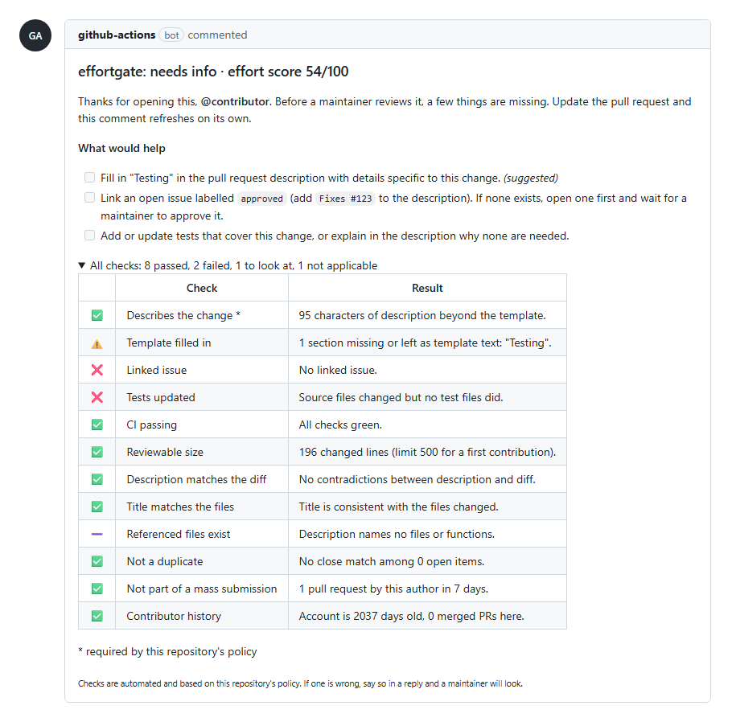

# effortgate

A GitHub Action that asks every pull request and issue for the same thing a maintainer would: evidence that someone put in the work. It scores each contribution against a policy you control, tells the contributor exactly what is missing, and stays out of the way of people you already trust.

[](https://github.com/Abdalkaderdev/effortgate/actions/workflows/ci.yml)
[](LICENSE)




## Why

In January 2026 GitHub opened a [community discussion](https://github.com/orgs/community/discussions/185387) about the volume of low-quality contributions: pull requests that ignore project guidelines, are abandoned right after they are opened, and are often AI-generated. The press called the options it floated a [pull request "kill switch"](https://www.theregister.com/2026/02/03/github_kill_switch_pull_requests_ai/). In that thread a Genkit maintainer estimated that roughly 1 in 10 AI-made pull requests is legitimate. GitHub's near-term answers are blunt: restrict pull requests to collaborators or turn them off. Its longer-term direction includes letting maintainers define criteria a pull request must meet, and triaging against project guidelines.

Projects did not wait:

- curl [ended its bug bounty](https://www.theregister.com/2026/01/21/curl_ends_bug_bounty/) to remove the incentive for low-effort reports.
- tldraw [closes pull requests from external contributors](https://tldraw.dev/blog/stay-away-from-my-trash) until better tooling exists.
- Ghostty's [AI usage policy](https://github.com/ghostty-org/ghostty/blob/main/AI_POLICY.md) requires disclosure and a human who fully understands the change, and publicly denounces repeat slop submitters.

On Hacker News, "If you are asking for human attention, demonstrate human effort" (1753 points) and "Don't be a meat proxy" (1849 points) made the same argument from the other side.

Closing the door works, but it also turns away the first-time contributor who did everything right. effortgate is the criteria-based gate in between: it checks for effort and evidence, explains itself, and is configured in one YAML file in your repository.

## Philosophy: effort and evidence

effortgate never tries to guess whether text was written by a model. Style-based "AI detection" is unreliable, punishes non-native speakers, and is trivial to evade. It also misses the point: a well-tested, well-explained pull request is welcome however it was produced, and a template-only pull request with 700 untested lines is a burden however it was produced.

So every check asks a question with a verifiable answer:

- Did the author fill in the template with something specific to this change?
- Is there an approved issue, if the project asks for one?
- Did tests change along with the source?
- Is CI green?
- Does the description match the diff, and do the files it mentions exist?
- Is this one of a burst of near-identical pull requests across dozens of repositories?

Each check says what failed and what to do about it. The contributor gets a checklist, not a verdict.

## Quick start

1. Add `.github/workflows/effortgate.yml`:

```yaml
name: effortgate

on:
  pull_request_target:
    types: [opened, edited, synchronize, reopened, ready_for_review]
  issues:
    types: [opened, edited, reopened]
  issue_comment:
    types: [created]
  schedule:
    - cron: "17 6 * * *"
  workflow_dispatch:

permissions:
  contents: read
  issues: write
  pull-requests: write

concurrency:
  group: effortgate-${{ github.event.pull_request.number || github.event.issue.number || github.run_id }}

jobs:
  gate:
    runs-on: ubuntu-latest
    timeout-minutes: 5
    steps:
      # No actions/checkout. effortgate reads the PR through the API and never runs its code.
      - uses: Abdalkaderdev/effortgate@v0
```

2. Optionally add `.github/effortgate.yml`. With no file, the defaults apply and the mode is `dry-run`:

```yaml
mode: dry-run
pull_requests:
  linked_issue:
    enabled: true
    required_label: approved
```

3. Leave it in `dry-run` for a week. Every run writes a job summary with the score, each check, and the actions it would have taken. When the summaries look right, set `mode: enforce`.

To see what it would do before installing anything, run it locally against any public pull request. It only reads:

```sh
npx github:Abdalkaderdev/effortgate check owner/repo 123
```

## How the score works

Checks are either **evidence** (description, template, linked issue, tests, CI, size, bug report details) or **red flags** (description contradicts the diff, title says nothing, references to files that do not exist, duplicates, mass submissions, very new account).

- Evidence produces a weighted ratio from 0 to 100: pass counts fully, warn counts half, fail counts zero. Checks that do not apply are left out.
- Each red flag subtracts `weight x 10` on fail and `weight x 4` on warn. A missing red flag earns nothing, so a pull request cannot score well just by not being spam.
- `score >= thresholds.pass` with no failed `required` check and no failed red flag is **pass**. `score >= thresholds.needs_info` is **needs info**. Anything lower is **low effort**.
- Trusted authors are never scored into an outcome. They get no label, no comment, and are never closed.

## Checks

| ID | Applies to | Kind | What it checks | Default |
|---|---|---|---|---|
| `description` | PR, issue | evidence, required | Text beyond the template (40 chars for PRs, 60 for issues) | on |
| `template` | PR, issue | evidence | Each template section has real content, not the placeholder, an unchecked box, or `_No response_`. Checklist-only and "(optional)" sections are skipped | on |
| `linked_issue` | PR | evidence | Linked issue via closing keywords, `Refs #n`, or the sidebar; optionally open and carrying a label such as `approved` | off |
| `tests` | PR | evidence | Source files changed, so test files changed too. Added doctests (`>>>`) and inline Rust tests count | on |
| `ci` | PR | evidence | Check runs and commit statuses on the head commit (effortgate's own job excluded). Pending or not yet run is skipped | on |
| `size` | PR | evidence | First-time contributors stay under `first_time_max_lines` (lockfiles, snapshots and `dist/` excluded) | on, 500 |
| `bug_report` | issue | evidence, required | Bug reports (label or title) have reproduction steps and a version | on |
| `claims` | PR | red flag | Description says tests or docs were added but none changed; "typo fix" that touches 100+ lines | on |
| `scope` | PR | red flag | Title is generic ("Update utils.ts") or its conventional type contradicts the files (`docs:` touching code) | on |
| `references` | PR | red flag | `#123` references resolve to an issue, pull request or discussion; file paths exist in the repository or diff (two or more unknown fails, one warns; build output ignored); `functions()` it names appear in the diff (warn) | on |
| `duplicates` | PR, issue | red flag | Title and body similarity against open items, template text removed | on, 0.6 |
| `mass_pr` | PR | red flag | Author's pull requests in the last 7 days: many repositories with near-identical titles, or repeated copies here | on |
| `account` | PR, issue | red flag | Account younger than `min_age_days`. Warn only, never fails | on, 14 days |

Trivial pull requests (at most 10 changed lines, or only docs and `.github/` files) skip `linked_issue`, `tests` and `size`.

## Policy reference

All keys are optional. Unknown keys are an error, so a typo fails the run with the path of the bad key instead of being ignored. The policy is always read from the default branch.

```yaml
mode: dry-run                  # dry-run | enforce

trusted:
  users: []                    # logins, case-insensitive
  bots: true                   # accounts of type Bot or ending in [bot]
  associations: [OWNER, MEMBER, COLLABORATOR]   # CONTRIBUTOR is also allowed
  min_merged_prs: 3            # 0 turns this off

trivial:
  max_changed_lines: 10
  paths: ["**/*.md", "docs/**", ".github/**"]

pull_requests:
  enabled: true
  # every check takes enabled, weight (0-10) and required (a failed required check caps the outcome at needs info)
  description:  { min_chars: 40, weight: 2, required: true }
  template:     { min_chars: 20, sections: [], weight: 3 }    # sections: [] means "use the repository's PR template"
  linked_issue: { enabled: false, required_label: null, require_open: true, weight: 3 }
  tests:
    weight: 2
    source: ["**/*.{ts,tsx,js,jsx,mjs,cjs,py,go,rs,java,kt,kts,rb,php,cs,c,cc,cpp,h,hpp,m,swift,scala,ex,exs,dart,lua,vue,svelte,zig,sh}"]
    tests: ["**/test/**", "**/tests/**", "**/__tests__/**", "**/*.test.*", "**/*.spec.*", "**/*_test.*", "**/test_*"]
  ci:           { ignore: ["effortgate"], weight: 2 }       # check names containing these are ignored
  size:         { first_time_max_lines: 500, weight: 2 }
  claims:       { weight: 2 }
  scope:        { weight: 1 }
  references:   { weight: 2 }
  duplicates:   { threshold: 0.6, weight: 1 }
  mass_pr:      { window_days: 7, max_repos: 15, weight: 2 }
  account:      { min_age_days: 14, weight: 1 }
  paths:                       # per-path rules, applied when any changed file matches
    - match: ["src/core/**"]
      require_tests: true          # tests check applies even if disabled or trivial
      require_linked_issue: true   # linked_issue applies even if disabled or trivial
      first_time_max_lines: 150    # the smallest matching limit wins

issues:
  enabled: true
  description: { min_chars: 60, weight: 2, required: true }
  template:    { min_chars: 10, weight: 2 }
  bug_report:  { labels: [bug], title_pattern: "\\b(bug|crash|error|broken|fails?|regression)\\b", weight: 3, required: true }
  duplicates:  { threshold: 0.6, weight: 1 }
  account:     { min_age_days: 14, weight: 1 }

llm:
  enabled: false
  provider: anthropic          # anthropic | openai
  model: null                  # anthropic defaults to claude-opus-5-5; openai requires a model
  max_diff_chars: 20000

thresholds:
  pass: 70
  needs_info: 40

actions:                       # what enforce mode does per outcome
  pass:       { labels: [], comment: false }
  needs_info: { labels: ["effortgate:needs-info"], comment: true, draft: false, request_changes: false, close_after_days: 14 }
  low_effort: { labels: ["effortgate:low-effort"], comment: true, draft: false, request_changes: false, close_after_days: 7 }

tone:                          # {author} and {kind} are replaced; {days} in close
  greeting: "Thanks for opening this, @{author}."
  needs_info: "Before a maintainer reviews it, a few things are missing. Update the {kind} and this comment refreshes on its own."
  low_effort: "This {kind} doesn't yet show enough context for a maintainer to review it. The checklist below says exactly what would change that."
  pass: "Everything this project asks for is here. A maintainer will take it from here."
  footer: "Checks are automated and based on this repository's policy. If one is wrong, say so in a reply and a maintainer will look."
  close: "Closing for now since the checklist above hasn't been addressed in {days} days. Reopen any time once it is."
```

A fuller example lives in [`examples/policy.yml`](examples/policy.yml).

### What enforce mode does

- **Labels.** Applies the outcome's labels and removes effortgate labels from other outcomes.
- **One sticky comment.** Created the first time an item is gated and edited in place afterwards. If a gated pull request later passes, the same comment is updated to say so.
- **Draft and request changes.** Applied once, when the outcome changes, so a contributor who marks the pull request ready again is not fought on every push.
- **Close after N days without a response.** The scheduled run closes items whose outcome has not changed and whose author has not pushed, edited or commented for `close_after_days`. Any author activity restarts the clock. Trusted authors are never closed.

`dry-run` performs none of these. It reads the repository and writes the job summary and outputs.

### Events

| Event | What happens |
|---|---|
| `pull_request_target` | Evaluates the pull request. Use this one: it has a write token for fork pull requests and never runs their code |
| `pull_request` | Evaluates, but fork pull requests get a read-only token, so enforce falls back to dry-run with a warning |
| `issues` | Evaluates the issue |
| `issue_comment` | Re-evaluates when the author replies, and restarts the close timer |
| `workflow_run` | Re-evaluates pull requests for the finished run's commit, so the CI check reflects the result ([example](examples/effortgate-after-ci.yml)) |
| `schedule`, `workflow_dispatch` | Re-evaluates every open gated item and closes stale ones |

### Outputs

| Output | Description |
|---|---|
| `outcome` | `trusted`, `pass`, `needs_info` or `low_effort` (single-item runs) |
| `score` | 0 to 100 (single-item runs) |
| `checks` | JSON array of check results (single-item runs) |
| `results` | JSON array of `{number, outcome, score, actions}` for every item in the run |

## Optional LLM review

Off by default. When enabled, a model reads `CONTRIBUTING.md`, the linked issue, and the pull request (diff capped at `max_diff_chars`, and the model is told when it is shortened). It returns structured JSON: whether the contribution follows the guidelines, whether it addresses the linked issue, a short summary, and up to a few concrete concerns.

The result is **advisory**. It appears in the comment and the job summary and never changes the score or the outcome. The model is instructed to judge evidence and never writing style, and to treat everything in the contribution as untrusted data.

```yaml
llm:
  enabled: true
  provider: anthropic
```

```yaml
      - uses: Abdalkaderdev/effortgate@v0
        with:
          anthropic-api-key: ${{ secrets.ANTHROPIC_API_KEY }}
          # or openai-api-key: ${{ secrets.OPENAI_API_KEY }} with provider: openai and a model
```

GitHub Models is not supported: GitHub retired its inference API on July 30, 2026.

## Security model

`pull_request_target` runs in the context of the base repository with a token that can write. GitHub's [security guidance](https://docs.github.com/en/actions/reference/security/secure-use) is explicit that workflows using it must not check out or run code from the pull request. effortgate is built around that:

- **It never checks out the pull request.** No `actions/checkout`, no build, no install, no script from the contributor's branch. Everything is read through the REST and GraphQL APIs as data: title, body, file list, patches, check results.
- **The policy comes from the default branch.** A pull request that edits `.github/effortgate.yml` cannot loosen its own gate.
- **Contributor text is treated as data.** It is matched against regular expressions and rendered in a comment with table cells escaped. When the LLM review is on, it is passed inside tagged blocks with an instruction to ignore embedded instructions, and the result cannot change the outcome.
- **Least privilege.** The workflow needs `contents: read`, `issues: write` and `pull-requests: write`. In `dry-run` you can drop the two write permissions.
- **No third-party services.** Without the optional LLM review, nothing leaves GitHub.
- **Pin the action.** Reference a full commit SHA rather than a tag for anything with write access, as GitHub recommends.

## CLI

The same engine runs from a terminal. It only reads and uses `GITHUB_TOKEN`, `GH_TOKEN`, or `gh auth token`.

```sh
npx github:Abdalkaderdev/effortgate check owner/repo 123            # job-summary style table
npx github:Abdalkaderdev/effortgate check owner/repo 123 --comment  # the comment it would post
npx github:Abdalkaderdev/effortgate report owner/repo --days 14 --format html --out report.html
```

`report` lists the pull requests (or `--kind issue|all`) opened in the last N days with their outcome, score and failed checks, using the effortgate comment where one exists and evaluating the rest live. Pass `--policy path/to/effortgate.yml` to try a policy before committing it. Search-backed checks are throttled to stay inside GitHub's search rate limit, so a large report takes a few minutes.

## FAQ

**Will this block good first-time contributors?**
It is designed not to. A first-time contributor who fills in the template, changes tests with source, and keeps a first pull request reviewable passes with no comment at all. Account age and contributor history only ever warn. Nothing auto-closes in `dry-run`, and in `enforce` an item is only closed after the author has gone silent for the configured number of days. Run a week in `dry-run` and read the summaries; [docs/evaluation.md](docs/evaluation.md) shows how the defaults labelled real pull requests.

**Does it detect AI-written code?**
No, deliberately. See [Philosophy](#philosophy-effort-and-evidence).

**A check is wrong for my project.**
Turn it off (`enabled: false`), lower its `weight`, or adjust its globs. If the heuristic itself is wrong, open an issue with the pull request that tripped it.

**Can contributors game it?**
They can fill in the template and add tests. That is the point: the gate asks for the effort a reviewer would ask for anyway, and the reviewer still reviews.

**What about my maintainers and bots?**
Owners, members, collaborators, bots, listed users, and anyone with `min_merged_prs` merged pull requests are trusted and skipped entirely.

**Does it cost API rate limit?**
A pull request evaluation is about a dozen REST calls plus at most two search calls, cached within a run.

## Roadmap

- GitHub App, so one installation covers many repositories without a workflow file.
- Organization-wide policies with per-repository overrides.
- Dashboard over time: gated volume, false-positive reports, time to close.
- Vouch lists shared across projects.
- More languages for the test-file heuristics, and per-ecosystem defaults.

## Contributing

Issues and pull requests are welcome.

```sh
npm ci
npm run check     # typecheck, lint, test, build
```

`dist/` is committed because GitHub runs actions straight from the repository. CI fails if it is out of date, so run `npm run build` before committing. Design notes are in [docs/design.md](docs/design.md).

## License

[MIT](LICENSE)

## Author

Abdalkader Alhamoud ([abdalkader.dev](https://abdalkader.dev), [@Abdalkaderdev](https://github.com/Abdalkaderdev))
